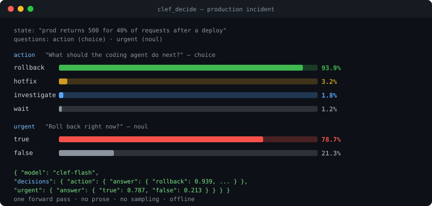
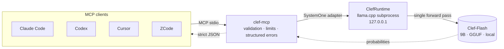

<div align="center">



# clef-mcp

[](https://www.npmjs.com/package/clef-mcp)
[](https://www.npmjs.com/package/clef-mcp)
[](https://github.com/HighlyLoadedEgo/ClefMCP/actions/workflows/ci.yml)
[](https://registry.modelcontextprotocol.io)
[](LICENSE)

**Local decisions for AI agents. Reusable classification for your datasets.**

Run **Clef-Flash** (9B, Apache-2.0 by Cloudflare) locally. Give coding agents a structured [MCP](https://modelcontextprotocol.io) decision tool, or classify JSONL/CSV datasets with YAML profiles. Get probabilities and explicit review results instead of generated prose. Inference stays on your machine.

</div>

---

## Quick start

Requires Node.js 20+ and enough memory for the selected model (16 GB recommended for Q4_K_M). The default model download is approximately 6 GB; subsequent inference runs offline.

```bash
npm install -g clef-mcp
clef-mcp install
```

Choose your workflow:

| Workflow | Start here |
|---|---|
| Decisions inside Claude Code, Codex, Cursor or ZCode | `clef-mcp setup`, then restart your client; [client configuration](#register-with-your-mcp-client) |
| Classify tickets, documents or other records | [YAML profiles and dataset classification](#classify-jsonlcsv-with-a-yaml-profile) |
| Hooks, CI or shell scripts | [`clef-mcp decide`](#scripting--hooks) |

The MCP server starts with `clef-mcp` (stdio). Only `install` downloads model/runtime files. You can also use `npx -y clef-mcp` instead of a global install; `npx -y clef-mcp install --setup` combines model installation and client registration.

## Classify JSONL/CSV with a YAML profile

Define a task once, then apply it to separate records. The model loads once for the whole batch; a separate daemon is not required.

Save this as `support-routing.yaml`:

```yaml
schema_version: 1
name: support-routing
instructions: Classify the current support request into exactly one department.
labels:
  billing: Payments, refunds, invoices and subscription charges
  technical: Errors, outages, installation and integration problems
  other: Requests outside billing and technical support
input:
  id_field: id
  fields: [subject, body]
policy:
  min_probability: 0.80
  min_margin: 0.15
```

Save `tickets.jsonl` (one object per line):

```jsonl
{"id":"001","subject":"Duplicate charge","body":"Please refund my duplicate subscription payment."}
{"id":"002","subject":"Checkout crashes","body":"The payment page returns an error."}
```

Or use `tickets.csv` with a header row:

```csv
id,subject,body
001,Duplicate charge,Please refund my duplicate subscription payment.
002,Checkout crashes,The payment page returns an error.
```

```bash
clef-mcp classify tickets.jsonl --profile support-routing.yaml --output results.jsonl
clef-mcp classify tickets.csv --profile support-routing.yaml --output csv-results.jsonl
# stdout carries JSONL; summaries and diagnostics go to stderr
cat tickets.jsonl | clef-mcp classify - --profile support-routing.yaml
# Extension override, including CSV on stdin
cat tickets.csv | clef-mcp classify - --format csv --profile support-routing.yaml
```

Runnable files also ship in [`examples/classify/`](examples/classify/).

### Profile fields

| Field | Meaning |
|---|---|
| `schema_version` | Required; currently `1` |
| `name` | Required profile ID, up to 64 letters/digits/underscores/hyphens, starting with a letter or digit |
| `instructions` | Required classification question |
| `labels` | Required map of 2–100 mutually exclusive label IDs to descriptions; include a fallback category where appropriate |
| `model` | Optional model ID; priority is CLI `--model` → profile → `CLEF_MODEL` → `clef-flash` |
| `input.fields` | Optional exact top-level field names to send to the model; otherwise use the full record |
| `input.id_field` | Optional string/numeric ID to copy to the result; missing or invalid IDs become row errors |
| `policy.min_probability` | Minimum winning probability, default `0.80` |
| `policy.min_margin` | Minimum difference between the two highest probabilities, default `0.15` |
| `policy.min_confidence` | Optional minimum runtime-reported confidence; missing confidence then requires review |
| `examples` | Optional list of up to 20 `{input: {...}, label: configured_label}` references |

Examples are data supplied alongside the current record; they do not train or modify model weights. Unknown fields, duplicate YAML keys, aliases, merge keys, unsupported tags and non-JSON values are rejected. Label IDs use the same character rules as profile names, with a 128-character limit; prototype-shaped reserved keys are rejected. Missing selected fields produce row errors.

### Accepted results and `needs_review`

Illustrative results (actual probabilities depend on your data and runtime):

```jsonl
{"row":1,"id":"001","profile":"support-routing","model":"clef-flash","status":"classified","label":"billing","suggested_label":"billing","probability":0.92,"margin":0.87,"probabilities":{"billing":0.92,"technical":0.05,"other":0.03},"review_reasons":[]}
{"row":2,"id":"002","profile":"support-routing","model":"clef-flash","status":"needs_review","label":null,"suggested_label":"technical","probability":0.48,"margin":0.06,"probabilities":{"billing":0.42,"technical":0.48,"other":0.10},"review_reasons":["low_probability","low_margin"]}
```

`classified` means all configured thresholds passed. `needs_review` keeps the suggestion and full distribution but sets `label: null`. Reasons are `low_probability`, `low_margin`, `tie`, `low_confidence` or `missing_confidence`. Exact ties always require review, including when thresholds are zero. Comparisons are inclusive at the threshold. Results may include model `confidence` and token `usage` when available.

Winning probability, probability margin and model-reported confidence are different quantities. These thresholds are routing policy, not a calibrated accuracy guarantee. Check them on representative labeled data before automating decisions. Classification does not grant authorization or execute actions.

Invalid JSONL objects and missing fields produce `status: "error"` rows and processing continues. Runtime failures stop the run; they are never converted to review decisions. Output includes identifiers and results, not a copy of the original record.

### Resume, formats and limits

```bash
clef-mcp classify tickets.jsonl --profile support-routing.yaml --output results.jsonl --resume
```

File output creates private `results.jsonl` and `results.jsonl.meta.json` files. The sidecar fingerprints the full input, validated profile, effective model, runtime and format. Resume requires all of these to match. Use a new output path after changing data or thresholds; existing files are never silently overwritten. Input must stay unchanged while a run is active.

Resume skips the contiguous committed prefix, including committed error rows; it does not retry those errors. An incomplete final write is discarded, while corruption in a complete row is rejected. Resume requires regular file input and `--output`; stdin/stdout resume is unsupported. A local lock prevents simultaneous writers. Dead local writer locks can be reclaimed; active, foreign-host or unverifiable locks are preserved. A crash during lock acquisition may leave `.lock.claim`, which requires inspection before manual removal.

JSONL accepts objects, ignores blank lines and supports UTF-8 BOM/CRLF. CSV supports quoted commas, escaped quotes and multiline fields; headers must be nonempty and unique, with consistent column counts. CSV cells remain strings, preserving IDs such as `001`. Format defaults to `.jsonl`/`.csv`, or JSONL for stdin; other extensions need `--format`.

Profiles and logical records are limited to 1 MiB, YAML nesting to 64 levels, selected/CSV fields to 1000, and examples to 20. Existing instruction/criteria/state limits and the model's 16k-token context also apply; selected fields and examples share that context. Oversized JSONL rows are reported as row errors. Broken/oversized CSV syntax stops the run because record boundaries cannot be recovered reliably.

| Exit code | Meaning |
|---|---|
| `0` | Completed; review results are allowed |
| `1` | Row errors occurred in this invocation, or inference/output failed |
| `2` | Invalid options/profile/input structure or incompatible checkpoint |
| `3` / `4` | Model not installed / runtime missing |
| `130` | Interrupted; committed file output can be resumed |

### Update

```bash
npm install -g clef-mcp@latest
```

Restart MCP clients and any existing daemon after updating. An already installed model does not need another download.

## Why not just ask the LLM?

| | Chat LLM | `clef_decide` |
|---|---|---|
| Output | prose, you parse it | strict JSON: probability per option |
| Determinism | varies per run | single forward pass, no sampling |
| Latency (1 decision) | seconds of generation | ~0.5 s local |
| Context cost | grows with every decision | fixed, small schema |
| Privacy | depends on provider | 100% on-device, works offline |
| Calibration | vibes | softmax over trained option scores |

Sweet spot: **decision points inside agent loops** — next action, routing, classification, severity, yes/no judgment — asked dozens of times per task.

## The `clef_decide` tool

```json
{
  "state": {
    "task": "Fix failing tests",
    "error": "TypeError: Cannot read properties of undefined"
  },
  "questions": {
    "next_action": {
      "type": "choice",
      "instructions": "What should the coding agent do next?",
      "criteria": {
        "inspect": "Inspect the code and gather more information",
        "modify": "Modify the code",
        "test": "Run additional tests",
        "ask_user": "Ask the user for clarification"
      }
    },
    "confidence": {
      "type": "score",
      "instructions": "How confident are you in this decision?",
      "criteria": ["very_low", "low", "medium", "high", "very_high"]
    },
    "is_outage": { "type": "noul", "instructions": "Is a service down?" }
  }
}
```

| Type | Criteria | Answer |
|------|----------|--------|
| `choice` | map `option id → description`, or a plain list | probability per option |
| `score` | ordered list (index = score) | probability per level |
| `noul` | optional `{"true": "...", "false": "..."}` | `{"true": p, "false": 1-p}` |

Response — strictly structured, never prose. Each decision carries the model-reported `confidence` (when the runtime sends it), plus token `usage` for the call:

```json
{
  "model": "clef-flash",
  "decisions": {
    "next_action": { "answer": { "inspect": 0.72, "modify": 0.12, "test": 0.14, "ask_user": 0.02 }, "confidence": 0.83 },
    "confidence":  { "answer": { "very_low": 0.01, "low": 0.04, "medium": 0.18, "high": 0.61, "very_high": 0.16 }, "confidence": 0.61 },
    "is_outage":   { "answer": { "true": 0.9, "false": 0.1 } }
  },
  "usage": { "input_tokens": 228, "output_tokens": 0, "latency_ms": 512 }
}
```

Act on the argmax only when the distribution is decisive — top p ≥ 0.8 and high `confidence` for destructive or security-adjacent calls.

Batch up to **64 questions per call** — they are scored in one forward pass. `state` is treated strictly as **data**: never executed, never interpreted as instructions for the server.

## Prompts & resources

The server ships four MCP **prompts** (canned, decision-shaped asks — your client lists them via `prompts/list`):

| Prompt | Purpose |
|---|---|
| `incident-triage` | action + severity + user-impact questions for a production incident |
| `next-action` | what the coding agent should do next + confidence |
| `ticket-routing` | classify a message into a team + urgency |
| `security-review` | vulnerability yes/no, risk scale, first mitigation |

And three **resources** (read-only, no model needed):

| URI | Contents |
|---|---|
| `clef-mcp://capabilities` | live JSON: model, runtime, limits, error codes |
| `clef-mcp://evals/schema` | how to write eval cases |
| `clef-mcp://evals/dataset` | the bundled 30-case dataset |

## Measured, not marketed

Apple M4 Pro, Clef-Flash Q4_K_M (6 GB), single request through the full MCP stdio path:

| Scenario | Latency |
|---|---|
| Cold start (incl. model load, once per session) | ~4.4 s |
| 1 question | ~0.5 s |
| 10 questions, one call | ~2.9 s |
| 64 questions, one call | ~18.6 s |

Quality gate: a 30-case evaluation dataset (coding / security / classification / routing / yes-no) — **86.7% pass** on the live model. Run it yourself: `clef-mcp evals`.

## Register with your MCP client

<details open>
<summary><b>Claude Code</b></summary>

```bash
claude mcp add clef-mcp -- clef-mcp
# or, without a global install:
claude mcp add clef-mcp -- npx -y clef-mcp
```
</details>

<details>
<summary><b>Codex</b> — <code>~/.codex/config.toml</code></summary>

```toml
[mcp_servers.clef-mcp]
command = "clef-mcp"
args = []
```
</details>

<details>
<summary><b>Cursor</b> — <code>.cursor/mcp.json</code></summary>

```json
{
  "mcpServers": {
    "clef-mcp": { "command": "clef-mcp", "args": [] }
  }
}
```
</details>

<details>
<summary><b>ZCode</b> — <code>~/.zcode/cli/config.json</code> (user scope, auto-connect)</summary>

```json
{
  "mcp": {
    "servers": {
      "clef-mcp": { "command": "clef-mcp", "args": [], "type": "stdio" }
    }
  }
}
```
</details>

Ready-made snippets: [`examples/`](examples/).

## Scripting & hooks

No MCP client required — hooks, CI jobs and shell scripts call the same model one-shot:

```bash
# Full document on stdin
echo '{"state": "checkout 500s after deploy", "questions": {"is_outage": {"type": "noul", "instructions": "Is a service down?"}}}' \
  | clef-mcp decide

# Or split across files
clef-mcp decide --questions questions.json --state state.json
```

stdout carries the strict JSON result (same shape as the MCP tool, including `confidence` and `usage`); errors go to stderr as structured JSON with exit codes: `2` invalid input, `3` model not installed, `4` runtime missing. `decide` never downloads anything.

Model selection: `--model <id>` overrides the input document's `model`, which overrides `CLEF_MODEL` (default: `clef-flash`). The same precedence applies with `--daemon`.

Each plain `decide` invocation is a cold start (model load included, a few seconds) — fine for gates and triage. For repeated calls, start `clef-mcp daemon` once: it keeps the model warm on an owner-only (`0600`) unix socket in `CLEF_HOME` (no TCP port, unloads after `CLEF_DAEMON_IDLE` seconds of inactivity following the last completed decision, default 600). Active and queued requests prevent idle unloading. `clef-mcp decide --daemon` answers in well under a second, falling back to a cold run when no daemon is running. See [`examples/hooks/`](examples/hooks/) for a PreToolUse guard and a GitHub Action recipe.

The PreToolUse guard blocks a command when the model judges it destructive (p ≥ 0.9) and tells the agent to **ask the user** — a block is a pause plus escalation, not a wall; the gate is advisory by design and says so. First real firing on day one: caught a history-rewrite force push (p=0.94) and surfaced its own bypass vector, which is now fixed and documented in the recipe.

## Teach your agent (skill)

The schema tells the client *what* `clef_decide` accepts; agents also need to know *when* to reach for it and *how* to frame decisions. The bundled [`clef-decisions`](skills/clef-decisions/SKILL.md) skill covers decision patterns, batching, criteria writing, distribution interpretation and error recovery:

```bash
clef-mcp setup                                                    # automatic
cp -r skills/clef-decisions ~/.agents/skills/                     # manual, from repo
cp -r "$(npm root -g)/clef-mcp/skills/clef-decisions" ~/.agents/skills/  # from npm package
```

## Architecture



The `ClefRuntime` interface (`load / decide / unload / health`) isolates the engine: MLX or remote runtimes plug in without changing the MCP API. The wire format is `POST /v1/systemone` — the same contract across llama.cpp and other Clef runtimes.

## CLI

```bash
clef-mcp              # run the MCP server on stdio (default command)
clef-mcp decide       # one-shot decision (no MCP session): JSON in, JSON out — for hooks, CI, scripts
clef-mcp classify     # apply a YAML profile to JSONL/CSV records; review uncertain results
clef-mcp daemon       # keep the model warm on a local unix socket; `decide --daemon` uses it
clef-mcp install      # detect hardware → download model + runtime → verify checksum → verify inference
clef-mcp setup        # register the MCP server + agent skill in zcode / claude-code / codex / cursor
clef-mcp models       # list models/quantizations and install status
clef-mcp status       # runtime, model, memory summary
clef-mcp doctor       # full diagnosis (platform, RAM, GPU, binary, model, checksum*, inference, MCP config)
clef-mcp uninstall    # remove the model (and optionally the managed runtime)
clef-mcp evals        # run the evaluation dataset against the installed model
```

Flags: `install --quant Q8_0 --yes --skip-probe`, `install --setup`, `setup --clients zcode,cursor --no-skill`, `doctor --deep` (re-hash the model file), `uninstall --runtime --yes`.

## Runtimes: llama.cpp and MLX

Two local runtimes behind the same `ClefRuntime` interface:

| | `llama-cpp` (default) | `mlx` |
|---|---|---|
| Platforms | macOS, Linux, Windows | macOS / Apple Silicon only |
| Model | GGUF from `ggml-org/Clef-Flash-GGUF` | MLX 4-bit from `mlx-community/clef-flash-4bit` |
| Extras | none | [uv](https://docs.astral.sh/uv/) on PATH (managed Python env) |
| Install | `clef-mcp install` | `clef-mcp install --runtime mlx` |

Switch at runtime with `CLEF_RUNTIME=mlx` (must be set for the MCP server process — e.g. in the client's `env` block). Both speak the same `POST /v1/systemone` contract. The MLX snapshot is fetched into `CLEF_HOME` via a uv-managed `huggingface_hub` (no global Python state) at a pinned revision.

## Configuration

| Variable | Default | Meaning |
|----------|---------|---------|
| `CLEF_MODEL` | `clef-flash` | Model id (per-call `model` also accepted) |
| `CLEF_HOME` | `~/.cache/clef-mcp` | Cache/model home |
| `CLEF_RUNTIME` | `llama-cpp` | `llama-cpp` \| `mlx` |
| `CLEF_LOG_LEVEL` | `error` | `error` \| `warn` \| `info` \| `debug` (stderr only) |
| `CLEF_LLAMA_BIN` | – | Explicit `llama-server` binary path (llama-cpp runtime) |
| `CLEF_LLAMA_RELEASE_TAG` | latest nightly | Pin the managed llama.cpp build |
| `CLEF_LLAMA_BATCH` | `8192` | llama.cpp physical batch (multi-question requests) |
| `CLEF_MLX_UV` | `uv` on PATH | Explicit uv binary (MLX runtime) |
| `CLEF_DAEMON_IDLE` | `600` | Seconds of idle before the daemon unloads the model (0 = never) |
| `CLEF_MAX_QUESTIONS` | `64` | Max questions per call |
| `CLEF_MAX_STATE_BYTES` | `1048576` | Max serialized `state` size |
| `CLEF_MAX_INSTRUCTION_CHARS` | `10000` | Max chars per question instructions |

Runtime resolution: `CLEF_LLAMA_BIN` → managed binary in `CLEF_HOME/runtime` → `llama-server` on `PATH`.

Storage: `CLEF_HOME/models/<model>/<quant>/` (model + `manifest.json` with repo/revision/sha256/license) and `CLEF_HOME/runtime/llama.cpp/`.

The model is downloaded from the pinned official GGUF conversion ([ggml-org/Clef-Flash-GGUF](https://huggingface.co/ggml-org/Clef-Flash-GGUF)) and **sha256-verified** against Hugging Face's content hash. It is never repackaged by clef-mcp. Also listed in the [official MCP Registry](https://registry.modelcontextprotocol.io) as `io.github.HighlyLoadedEgo/clef-mcp`.

## Error handling

```json
{
  "error": {
    "code": "MODEL_NOT_INSTALLED",
    "message": "Clef model \"clef-flash\" is not installed.",
    "hint": "Run `clef-mcp install`."
  }
}
```

Codes: `MODEL_NOT_INSTALLED`, `MODEL_LOAD_FAILED`, `RUNTIME_NOT_FOUND`, `RUNTIME_INIT_FAILED`, `RUNTIME_NOT_SUPPORTED`, `INVALID_INPUT`, `CLEF_INFERENCE_FAILED`, `UNSUPPORTED_PLATFORM`, `OUT_OF_MEMORY`, `CHECKSUM_MISMATCH`, `DOWNLOAD_FAILED`. Input exceeding the 16k-token model context is rejected with a hint to reduce the state.

## Security & data handling

- No public network service, telemetry or accounts. MCP uses stdio; inference uses local loopback HTTP, and the optional daemon uses a local Unix socket.
- The model downloads only on an explicit `install`, over HTTPS, checksum-verified.
- `state` content is passed to the model as data; the server never executes or instruction-interprets it.
- Model/runtime storage stays in `CLEF_HOME`. Classification also reads the input/profile paths you supply and writes explicit output/checkpoint paths; setup/doctor inspect or update supported client configuration.
- The managed runtime is the official llama.cpp build; pin it with `CLEF_LLAMA_RELEASE_TAG`.

See [SECURITY.md](SECURITY.md) for the full policy.

## Development

```bash
npm install
npm run build
npm test          # unit + integration (fake llama-server, no model needed)
npm run evals     # needs an installed model; exit code reflects pass rate
```

See [CONTRIBUTING.md](CONTRIBUTING.md) and [`tests/evals/dataset.jsonl`](tests/evals/dataset.jsonl).

## License

- Code: [Apache-2.0](LICENSE).
- Clef / Clef-Flash model: © Cloudflare, [Apache-2.0](https://huggingface.co/Cloudflare/clef-flash) — see [NOTICE](NOTICE).
- llama.cpp runtime: © its authors, MIT-licensed; downloaded as an official prebuilt binary.
